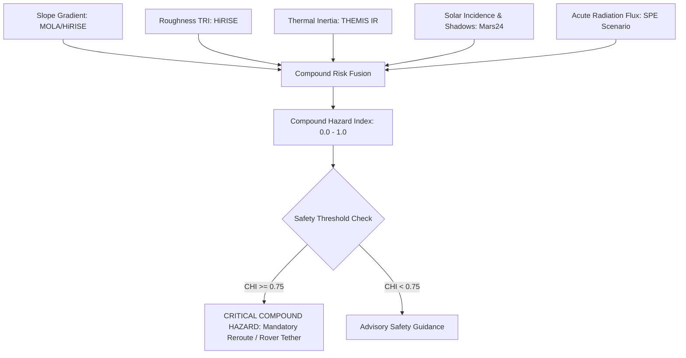

# Compound Environmental Risk Fusion Architecture

**Subsystem:** Environmental Stress Testing & Multi-Hazard Sensor Fusion  
**Layer:** Bayesian & Multi-Criteria Hazard Integration (Risk Propagation Engine)  
**Safety Mandate:** Deterministic Physical Boundaries Supersede AI / Heuristic Guidance.

---

## 1. The Compound Hazard Challenge in Planetary EVA

Individual Martian hazards are rarely encountered in isolation. A moderate slope of $8^\circ$ on firm, cemented bedrock (THEMIS thermal inertia $>350\text{ tiu}$) is safe for suited walking. However, the exact same $8^\circ$ slope occurring simultaneously with:
1. Low thermal inertia ($<180\text{ tiu}$, representing deep aeolian sand dunes with high boot slip),
2. Rapid sunset shadow ingress ($\Delta t_{\text{sunset}} < 45\text{ min}$, causing rapid $-50^\circ\text{C}$ temperature drop), and
3. High surface roughness ($\text{TRI} > 0.4\text{ m}$, sub-meter basalt blocks)
creates an exponentially compounding hazard that can immobilize an astronaut.

---

## 2. Multi-Criteria Risk Matrix

The Compound Hazard Index $\text{CHI} \in [0.0, 1.0]$ is evaluated for every corridor waypoint:

$$\text{CHI} = w_s \cdot \hat{S} + w_r \cdot \hat{R} + w_t \cdot \hat{T} + w_i \cdot \hat{I}_{\text{shadow}} + w_e \cdot \hat{E}_{\text{spe}}$$

Where normalized indicators $[0, 1]$ are weighted according to astronaut physiological vulnerability:
- $w_s = 0.30$ (Slope gradient relative to $14^\circ$ limit)
- $w_r = 0.20$ (Surface roughness relative to $1.0\text{ m}$ TRI)
- $w_t = 0.20$ (Regolith sinkage proxy: $(400 - \min(400, I)) / 300$)
- $w_i = 0.15$ (Shadow ingress index: $\max(0, 1.0 - \Delta t_{\text{sunset}} / 60)$)
- $w_e = 0.15$ (Radiation storm intensity multiplier: $1.0$ during active SPE, $0.0$ nominal)

---

## 3. Mandatory Non-Override Safety Protocol

In compliance with NASA Autonomous Systems Safety Standards:
> **DETERMINISTIC SAFETY PROTOCOL:**  
> AI mission intelligence and heuristics are strictly advisory and grounded on genuine NASA PDS orbital/in-situ telemetry. Under no circumstance may heuristic scoring or AI LLM recommendations override physical engineering safety limits (e.g., the strict 14.0° slope ceiling or maximum 8.0-hour EVA consumables budget).
