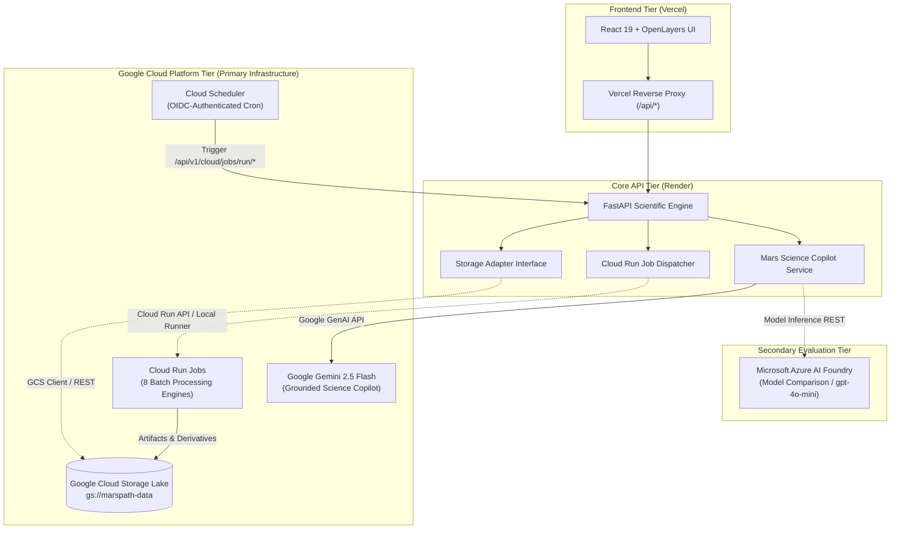

# Google Cloud Platform Architecture & Integration Overview

## 1. Executive Summary

MARSPath utilizes **Google Cloud Platform (GCP)** as its primary scientific infrastructure and batch processing backbone, while keeping web traffic hosted on Vercel and the core FastAPI application hosted on Render. This hybrid multi-cloud architecture avoids unnecessary platform lock-in and eliminates redundant compute costs.



---

## 2. Architecture Principles & Constraints

1. **No Migration of Existing Production Services:**
   - The production frontend remains permanently deployed on **Vercel** (`https://marspath.vercel.app/`).
   - The production backend remains permanently deployed on **Render** (`https://marspath-backend.onrender.com/`).
   - GCP provides auxiliary storage, batch crunching, and AI intelligence without requiring full app re-hosting.

2. **Zero-Cost Billing Protection Sandbox:**
   - MARSPath is engineered with a strict **Zero-Cost Local Sandbox Mode** (`MARSPATH_GCS_ENABLED=false`, `MARSPATH_CLOUD_JOBS_ENABLED=false`).
   - In sandbox mode, all GCS bucket operations, Cloud Run jobs, and AI synthesis run using local filesystem emulation and offline grounded NASA scientific datasets.
   - No cloud billing is incurred during automated CI testing or local offline execution.

3. **Deterministic Geospatial Integrity:**
   - Raw elevation DEMs, slope derivatives, and traverse corridors remain deterministic.
   - AI outputs (Gemini and Azure Foundry) are treated strictly as **explanatory scientific hypotheses**, never overriding deterministic A* or Dijkstra traversal safety constraints.

---

## 3. Subsystem Breakdown

| Subsystem | Technology | Purpose | Zero-Cost Fallback |
| :--- | :--- | :--- | :--- |
| **Data Lake** | Google Cloud Storage (GCS) | Central repository for raw NASA archives, COGs, terrain derivatives, and tiles | `LocalStorageAdapter` mirrors directory tree in `backend/app/data/storage/marspath-data/` |
| **Batch Engines** | Cloud Run Jobs | 8 containerized batch jobs executing high-compute geospatial tasks (tiling, slope calculation, sync) | In-process execution runner via `CloudRunJobRegistry` |
| **Automated Sync** | Cloud Scheduler | Cron-based triggers for daily NASA catalog sync, hourly MEDA weather ingestion, and weekly provenance audits | Internal scheduling service with declarative YAML definitions |
| **Primary AI Copilot** | Google Gemini 2.5 Flash | Grounded planetary science copilot for route explanation, mineralogical queries, and mission assistance | Deterministic scientific synthesis engine grounded in authentic NASA mission archives |
| **Evaluation AI** | Microsoft Azure AI Foundry | Secondary AI provider for model evaluation, citation alignment, and comparative risk benchmarking | Comparative assessment synthesis engine with citation verification |
| **Cost Controls** | CloudCostManager | Monitors daily/monthly spend, enforces 10 GB storage caps, 100k token limits, and auto-tiering rules | Static quota clamp in `ZERO_COST_LOCAL_SANDBOX` mode |

---

## 4. Environment Configuration

All GCP and AI integrations are configured via environment variables in `backend/app/core/config.py`:

```bash
# Google Cloud Platform Infrastructure
GOOGLE_CLOUD_PROJECT=marspath-production-441200
GOOGLE_CLOUD_LOCATION=us-central1
GCS_BUCKET=marspath-data
GOOGLE_APPLICATION_CREDENTIALS=/path/to/service-account.json
MARSPATH_GCS_ENABLED=false          # Set true to connect live GCS bucket
MARSPATH_CLOUD_JOBS_ENABLED=true    # Enables Cloud Run Jobs dispatcher

# Google Gemini AI Integration (Primary)
GEMINI_API_KEY=your-gemini-api-key
GEMINI_MODEL=gemini-2.5-flash
MARSPATH_GEMINI_ENABLED=true

# Microsoft Azure AI Foundry (Evaluation Mode)
AZURE_AI_FOUNDRY_ENDPOINT=https://your-foundry-resource.services.ai.azure.com/models
AZURE_AI_FOUNDRY_API_KEY=your-azure-key
AZURE_AI_FOUNDRY_MODEL=gpt-4o-mini
MARSPATH_AZURE_AI_ENABLED=true
```
