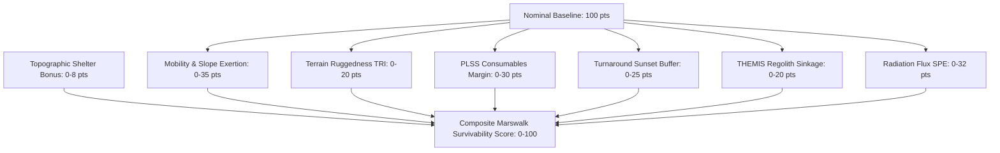

# Marswalk Survivability Score (MSS) — Mathematical Model & Decision-Support Formulation

**Project:** MARSPath — Martian Geospatial Intelligence & Astronaut EVA Navigation  
**Target Region:** Jezero Crater, Mars (18.38°N–18.52°N, 77.20°E–77.48°E)  
**Reference Analogs:** Apollo Lunar Surface Traverses, NASA EVA Consumables Guidelines (JSC-65829), Minetti Human Biomechanics Model, NASA PDS MGS MOLA / Mars 2020 HiRISE / 2001 Mars Odyssey THEMIS Data Products.

---

## 1. Executive Summary

The **Marswalk Survivability Score (MSS)** is a composite metric on a 0–100 scale that quantifies the multi-factor physical feasibility, metabolic exertion, life-support margin, and environmental risk for a suited astronaut performing Extravehicular Activity (EVA) on the surface of Mars.

Unlike rover path planning—which primarily minimizes mechanical energy, wheel slip, and geometric roll—human planetary surface traversal must account for suited bioenergetics, joint flexibility limitations in pressurized suits (e.g. xEMU / Artemis-generation planetary suits), portable life support system (PLSS) reserves, terrain foot-slipping (terramechanics), and rapid abort corridors in the event of acute Solar Particle Events (SPE).

> **Mandatory Scientific Disclaimer:**  
> The Marswalk Survivability Score is a conceptual operational decision-support metric based on terrestrial human terramechanics and NASA analog models. It is **not** a certified flight-safety rating and does not supersede deterministic engineering limits (e.g. 14.0° slope ceiling).

---

## 2. Mathematical Formulation

The composite Marswalk Survivability Score $S_{\text{marswalk}} \in [0, 100]$ is computed as:

$$S_{\text{marswalk}} = \max\left(0, \min\left(100, 100 - \sum_{i=1}^{6} P_i + B_{\text{shelter}}\right)\right)$$

Where $P_i$ are factor penalties and $B_{\text{shelter}}$ is a proximity shelter bonus under radiation stress.

---

### Factor 1: Suited Human Mobility & Slope Exertion Penalty ($P_{\text{slope}}$)

Pressurized spacesuits severely restrict knee and ankle articulation. Based on Minetti (2002) metabolic cost scaling adapted to Martian gravity ($g_{\text{mars}} = 3.72 \text{ m/s}^2$):

$$P_{\text{slope}} = 
\begin{cases} 
0.0 & \text{if } \theta_{\max} \le 6.0^\circ \\
3.0 \times (\theta_{\max} - 6.0^\circ) & \text{if } 6.0^\circ < \theta_{\max} \le 12.0^\circ \\
18.0 + 8.5 \times (\theta_{\max} - 12.0^\circ) & \text{if } 12.0^\circ < \theta_{\max} \le 14.0^\circ \\
35.0 & \text{if } \theta_{\max} > 14.0^\circ \text{ (Deterministic Ceiling)}
\end{cases}$$

- **Nominal ($<6^\circ$):** Easy walking; metabolic exertion $\approx 280\text{ W}$.
- **Caution ($6^\circ\text{–}12^\circ$):** Moderate exertion; metabolic rate climbs to $380\text{–}420\text{ W}$.
- **Critical ($>12^\circ$):** Heavy anaerobic exertion; companion rover winch or tether assistance advised.

---

### Factor 2: Terrain Ruggedness Index & Tripping Risk ($P_{\text{roughness}}$)

Surface roughness derived from USGS HiRISE 1m DTM (Terrain Ruggedness Index, TRI) measures sub-meter rock distribution and ankle inversion risk:

$$P_{\text{roughness}} = 
\begin{cases} 
0.0 & \text{if } \text{TRI} \le 0.20\text{ m} \\
20.0 \times (\text{TRI} - 0.20) & \text{if } 0.20 < \text{TRI} \le 0.60\text{ m} \\
8.0 + 30.0 \times (\text{TRI} - 0.60) & \text{if } 0.60 < \text{TRI} \le 1.00\text{ m} \\
20.0 & \text{if } \text{TRI} > 1.00\text{ m}
\end{cases}$$

---

### Factor 3: Suit Consumables Margin ($P_{\text{consumables}}$)

Assuming nominal NASA PLSS capacity ($T_{\text{PLSS}} = 8.0\text{ hours}$):

$$T_{\text{consumed}} = 2.0 \times T_{\text{traverse}} \quad \text{(Outbound + Return)}$$
$$f_{\text{reserve}} = \frac{T_{\text{PLSS}} - T_{\text{consumed}}}{T_{\text{PLSS}}} \times 100\%$$

$$P_{\text{consumables}} = 
\begin{cases} 
0.0 & \text{if } f_{\text{reserve}} \ge 40.0\% \\
0.75 \times (40.0\% - f_{\text{reserve}}) & \text{if } 20.0\% \le f_{\text{reserve}} < 40.0\% \\
15.0 + 0.75 \times (20.0\% - f_{\text{reserve}}) & \text{if } f_{\text{reserve}} < 20.0\% \quad (\max 30.0\text{ pts})
\end{cases}$$

---

### Factor 4: Safe Turnaround & Sunset Buffer ($P_{\text{buffer}}$)

Traversing in darkness on Mars introduces extreme thermal drop ($-80^\circ\text{C}$) and loss of visual navigation:

$$P_{\text{buffer}} = 
\begin{cases} 
0.0 & \text{if } \Delta t_{\text{sunset}} \ge 60\text{ min} \\
0.40 \times (60 - \Delta t_{\text{sunset}}) & \text{if } 30 \le \Delta t_{\text{sunset}} < 60\text{ min} \\
12.0 + 0.43 \times (30 - \Delta t_{\text{sunset}}) & \text{if } \Delta t_{\text{sunset}} < 30\text{ min} \quad (\max 25.0\text{ pts})
\end{cases}$$

---

### Factor 5: Regolith Traction & THEMIS Thermal Inertia ($P_{\text{sinkage}}$)

THEMIS nighttime thermal inertia ($I$, in $\text{J}\cdot\text{m}^{-2}\cdot\text{K}^{-1}\cdot\text{s}^{-1/2}$, tiu) differentiates fine dust from firm bedrock:

$$P_{\text{sinkage}} = 
\begin{cases} 
0.0 & \text{if } I \ge 300\text{ tiu (Cemented bedrock/duricrust)} \\
\frac{10.0}{150.0} \times (300 - I) & \text{if } 150 \le I < 300\text{ tiu (Coarse sand/pebbles)} \\
10.0 + 0.10 \times (150 - I) & \text{if } I < 150\text{ tiu (Loose dust mantle, sinkage }>5\text{cm}) \quad (\max 20.0\text{ pts})
\end{cases}$$

---

### Factor 6: Space Environment & Radiation Exposure ($P_{\text{radiation}}, B_{\text{shelter}}$)

- **Nominal Background (GCR):** $P_{\text{radiation}} = 0.0\text{ pts}$.
- **Simulated Solar Particle Event (SPE, Class X2.5):** Acute unshielded proton flux of $\approx 48.5\text{ mSv/h}$ imposes baseline penalty $P_{\text{radiation}} = 32.0\text{ pts}$.
- **Topographic Shelter Proximity Mitigation:** If distance $d_{\text{shelter}} \le 1200\text{ m}$ from a designated natural overhang:
  $$P_{\text{radiation}} \to 8.0\text{ pts}, \quad B_{\text{shelter}} = 8.0 \times \left(1.0 - \frac{d_{\text{shelter}}}{1200\text{ m}}\right)$$
  If $1200\text{ m} < d_{\text{shelter}} \le 3000\text{ m}$:
  $$P_{\text{radiation}} \to 18.0\text{ pts}, \quad B_{\text{shelter}} = 4.0 \times \left(1.0 - \frac{d_{\text{shelter}} - 1200\text{ m}}{1800\text{ m}}\right)$$

---

## 3. Score Categorization Matrix

| Score Range | Category | Color Code | Operational Meaning | Action Mandate |
|:---:|:---:|:---:|:---|:---|
| **80 – 100** | **OPTIMAL** | `#00ff88` (Green) | Nominal suited walkability; ample life-support reserves. | Proceed under normal 2-person buddy EVA protocols. |
| **65 – 79** | **GOOD** | `#a3e635` (Lime) | Minor slope or roughness; comfortable return margins. | Proceed; monitor PLSS oxygen consumption rate. |
| **45 – 64** | **MODERATE** | `#f59e0b` (Amber) | Elevated exertion or tight consumables buffer. | Companion rover escort recommended for forward tether. |
| **25 – 44** | **MARGINAL** | `#f97316` (Orange) | Steep gradients ($>10^\circ$) or loose dust sinkage. | Mandatory companion rover tether; evaluate alternate corridor. |
| **0 – 24** | **CRITICAL** | `#ef4444` (Red) | Immediate mission abort or severe environmental threat. | Corridor unviable for dismounted astronaut; abort to habitat. |

---

## 4. Code Implementation & Verification

- **Backend Logic:** `backend/app/routing/survivability.py`
- **Schemas:** `backend/app/schemas/routes.py` (`MarswalkSurvivabilityScore`)
- **Unit Tests:** `backend/tests/unit/test_marswalk_survivability.py` (5 tests passing)
- **Frontend Engine:** `mission-ui/src/engine.js` (`computeClientMarswalkSurvivability`)
- **Frontend Verification:** `mission-ui/check-marswalk-survivability.mjs` (All assertions passed)
