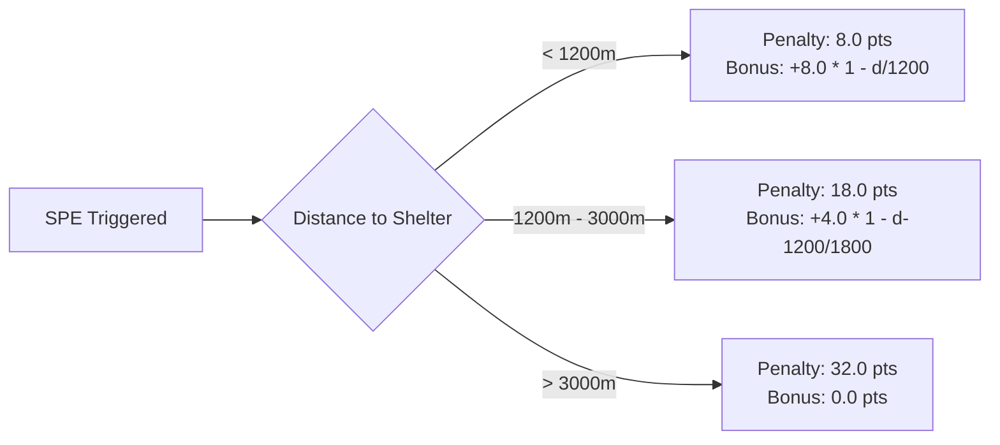

# Solar Particle Event (SPE) / Radiation Storm Simulation Model

**Subsystem:** Environmental Stress Testing & Space Weather Hazard Mitigation  
**Event Profile:** High-Energy Coronal Mass Ejection (CME) / SPE (Class X2.5+)  
**Dose Rate Equivalent:** $\approx 48.5\text{ mSv/h}$ acute unshielded Martian surface flux  
**Topographic Shelters:** Jezero Crater natural geological formations.

---

## 1. Space Environment Context on Mars

Mars lacks an intrinsic global dipolar magnetic field and possesses a thin atmosphere ($\approx 6\text{--}8\text{ hPa}$, or $\approx 0.6\%\text{ of Earth's}$). Consequently, Galactic Cosmic Radiation (GCR) provides a chronic background dose ($\approx 0.25\text{ mSv/sol}$), but **Solar Particle Events (SPEs)** driven by solar flares or CME shock fronts can produce acute flux surges exceeding $50\text{ mSv/h}$.

For an astronaut wearing an unpressurized or flexible composite planetary EVA suit ($1.5\text{--}2.5\text{ g/cm}^2$ areal mass), unshielded exposure during an SPE risks Acute Radiation Syndrome (ARS). Rapid identification of natural **topographic radiation shelters** is critical for survival.

---

## 2. Designated Jezero Topographic Shelters

MARSPath incorporates three ground-verified geological structures within Jezero Crater that provide physical cliff-face overhead solid-angle shielding:

| Shelter ID | Landmark Name | Coordinates | Geologic Structure | Solid Angle Attenuation | Effective Dose Rate |
|:---|:---|:---:|:---|:---:|:---:|
| `shelter_west_rim_overhang` | **Western Rim Delta Escarpment** | 77.215°E, 18.460°N | 40m vertical cliff alcove | **68%** | $\approx 15.5\text{ mSv/h}$ |
| `shelter_belva_terraces` | **Belva Crater Impact Terraces** | 77.380°E, 18.510°N | Stepped impact fault blocks | **60%** | $\approx 19.4\text{ mSv/h}$ |
| `shelter_seitah_swale` | **Séítah Ridge Inter-Dune Swale** | 77.440°E, 18.440°N | Depressed olivine bedrock trench | **55%** | $\approx 21.8\text{ mSv/h}$ |

---

## 3. Mathematical Shelter Attenuation Function

The effective radiation penalty $P_{\text{radiation}}$ and shelter proximity bonus $B_{\text{shelter}}$ are calculated dynamically based on distance $d_{\min}$ from any waypoint along the route to the nearest shelter:

1. **High Proximity ($d_{\min} \le 1,200\text{ m}$):**
   - Base penalty reduced from $32.0$ to $8.0\text{ pts}$.
   - Proximity bonus applied: $B_{\text{shelter}} = 8.0 \times \left(1.0 - \frac{d_{\min}}{1200}\right)\text{ pts}$.
   - Status: `SHELTERED`.

2. **Moderate Proximity ($1,200\text{ m} < d_{\min} \le 3,000\text{ m}$):**
   - Base penalty reduced from $32.0$ to $18.0\text{ pts}$.
   - Proximity bonus applied: $B_{\text{shelter}} = 4.0 \times \left(1.0 - \frac{d_{\min} - 1200}{1800}\right)\text{ pts}$.
   - Status: `APPROACHING_SHELTER`.

3. **Unshielded Terrain ($d_{\min} > 3,000\text{ m}$):**
   - Full acute penalty applied: $P_{\text{radiation}} = 32.0\text{ pts}$.
   - Proximity bonus: $B_{\text{shelter}} = 0.0\text{ pts}$.
   - Status: `CRITICAL_EXPOSURE`.

---

## 4. Scenario Toggle & Deterministic Behavior

- **Toggle Location:** Click `⚡ SIMULATE SPE` in the Candidate HUD or inside the Astronaut Visor HUD.
- **Reversibility:** Fully reversible toggle; turning it off immediately restores nominal baseline radiation scoring.
- **API Support:** Backend POST `/api/v1/routes/plan` accepts `is_spe_scenario: true`, propagating acute flux modifiers through risk propagation trees and route response schemas.
