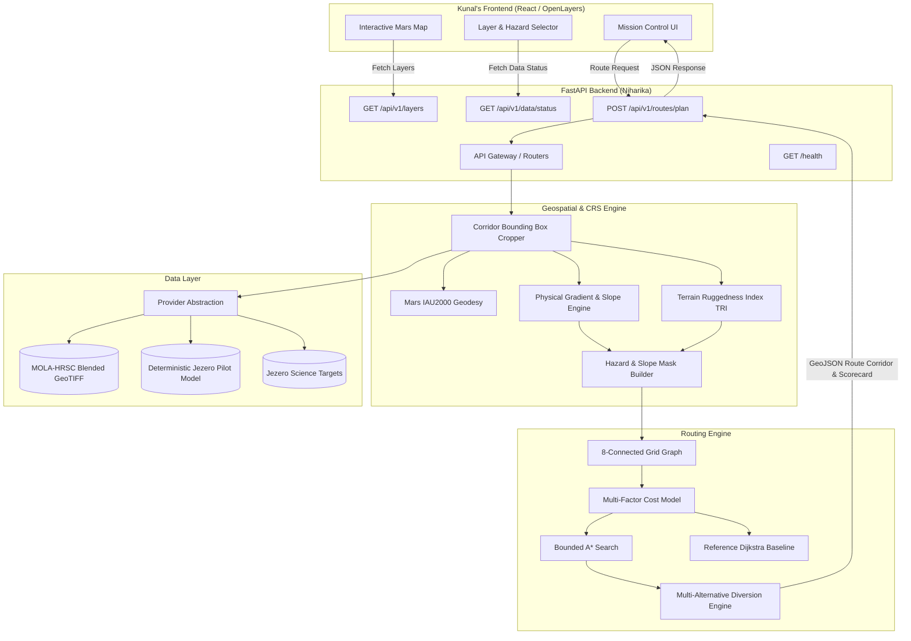

# MARSPath System Architecture

---

## Component Descriptions

1. **API Layer (`backend/app/api/`):** Thin REST endpoints validating incoming Pydantic schemas, enforcing planetary CRS rules, and handling exceptions.
2. **Geospatial Processing Engine (`backend/app/geospatial/`):** Converts planetary coordinates into local metric coordinates, crops subgrids around the mission corridor, and calculates physical slope gradients and roughness metrics strictly in meters.
3. **Data Provider Layer (`backend/app/data/providers/`):** Manages raster ingestion with graceful fallback to high-fidelity deterministic synthetic models when raw NASA files are not locally present.
4. **Routing Engine (`backend/app/routing/`):** Builds an 8-connected graph with strict diagonal corner-cutting prevention and executes bounded A* searches with admissible Euclidean heuristics.
